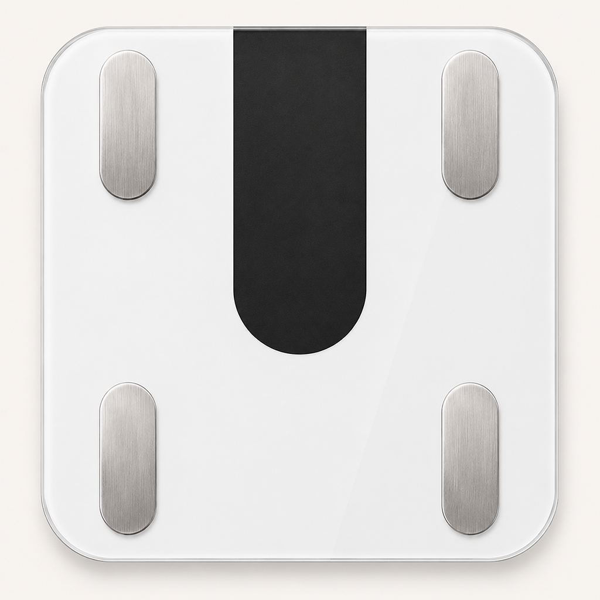

<div align="center">



# Scale · 蚂蚁阿福体脂秤

一个原生 iOS App，通过蓝牙连接蚂蚁阿福体脂秤，读取体重与阻抗，本地估算身体成分，并同步到 Apple「健康」。

</div>

## 简介

Scale 是用 SwiftUI 写的 iOS 体脂秤 App。手机作为蓝牙中心设备直接与体脂秤通信，无需依赖原厂 App 或云端：

- 打开 App 后在前台自动扫描并连接沃莱系列体脂秤（服务 UUID `FFB0`）；记住已连接的秤，连接失败时按 5–30 秒间隔自动重试，进入后台停止连接。
- 连接后向秤下发用户资料（身高 / 年龄 / 性别），触发它做阻抗测量。
- 解析秤的 "Scale27" 蓝牙协议（体重包 / 阻抗包），实时显示体重、稳定后锁定读数。
- 基于阻抗 + 用户资料，本地用 BIA 公式估算体脂率、BMI、水分率、肌肉率、基础代谢、去脂体重。
- 测量、身体资料和最近一次结果在本机处理和保留；App 不连接项目自建服务器或第三方数据服务。
- 首次测量、与本人最近记录相差超过设定范围（默认 ±3 kg）、或本人基线超过 30 天时，先确认归属再保存；共用秤可开启「每次都确认是本人」。
- 确认本人后，按设置自动把体重、体脂率、BMI、去脂体重写入 Apple「健康」App。失败保留本机待同步队列，打开 App 或手动重试补写；使用固定 HealthKit 同步标识避免重试产生重复记录。关闭健康同步会暂停补写。

### 自动同步的边界

秤需有电、唤醒并在蓝牙范围内；首次仍需授予蓝牙权限。当前在前台接收实时测量，以及秤主动发送的 `216` 历史包；不保证睡眠状态下连接或后台持续同步。参考协议未提供历史拉取命令，具体设备是否在连接后补传、是否补传完整，必须真机验收，不能保证未打开 App 时的所有记录可恢复。实时记录需先收到稳定体重包，再收到匹配的阻抗包；短时间重复读数会过滤。历史记录保留秤端 Unix 时间，拒绝无效时间、未来异常时间、损坏校验和或越界阻抗数量；按设备和原始记录信息生成固定标识防重。只处理协议已知的单包历史格式，不发送清除秤端记录的命令。体重接近不代表身份相同，共用秤建议开启每次确认。默认 3 kg 是可调整的产品过滤范围，不是医学判断标准。

待确认记录保存在本机，确认前不覆盖本人基线，也不写入健康；忽略后继续寻找秤。历史记录也经过相同的归属过滤，超过 30 天的历史记录需确认；已确认记录保留在本机（首页可展开最近 10 条），较早记录不会覆盖首页最新体重。健康同步需要四类数据的写入权限全部开启，否则保留记录并提示重试。若启用 HealthKit，Apple「健康」中的后续存储与同步由 iOS、Apple 健康和账户设置管理；本项目不提供远程同步服务。

> ⚠️ 体脂等身体成分由体脂秤原始阻值经本地公式估算，与原厂 App 的计算公式不完全一致，仅供日常趋势参考，不能用于医疗诊断或治疗决策。

## 构建与安装

本仓库发布应用源码、Xcode 工程和必要资源，不提供可直接安装的 IPA，也不是 App Store 分发渠道。请使用自己的 Mac 和 Apple 开发团队构建并签名；不要向第三方提供 Apple Account 密码、证书私钥或设备标识。

### 环境要求

- Mac 与 Xcode。
- iOS 16 或更高版本的 iPhone。
- 支持沃莱 Scale27 协议、广播服务 UUID FFB0 的体脂秤。
- 蓝牙测量和 HealthKit 写入需在实体 iPhone 上验收；模拟器仅适合编译和界面开发。

### 在 Xcode 中运行

1. 克隆仓库并打开 Scale.xcodeproj。
2. 选择 Scale App target，在 Signing & Capabilities 中开启 Automatically manage signing，并选择自己的 Team。
3. 若 Bundle Identifier 与已有应用冲突，在该 target 中换成自己控制的反向域名；保留 HealthKit capability。
4. 将 iPhone 连接到 Mac，在 Xcode 运行目标中选择设备并点击 Run。
5. 首次运行时允许蓝牙访问；启用健康同步后，按系统提示授权向 Apple「健康」写入数据。
6. 在资料页填写身高、年龄和性别。唤醒体脂秤并靠近手机后打开 App，按界面提示完成测量和本人确认。

个人开发团队的签名能力、有效期和设备限制由 Apple 与 Xcode 决定。本项目不提供第三方代签、证书或安装包。

### 无签名构建

在仓库根目录运行以下命令，可检查 iOS 目标的编译，不会生成可直接安装的已签名 App：

~~~bash
xcodebuild -project Scale.xcodeproj -scheme "Scale App" -configuration Debug -destination "generic/platform=iOS" CODE_SIGNING_ALLOWED=NO build
~~~

## 项目结构

| 路径 | 作用 |
| --- | --- |
| Scale.xcodeproj/ | Xcode 工程、共享 Scheme 与构建设置 |
| Scale/BodyScaleApp.swift | SwiftUI 应用入口 |
| Scale/ContentView.swift | 测量状态、结果展示、本人确认与资料设置界面 |
| Scale/BluetoothManager.swift | CoreBluetooth 扫描、连接、通知订阅、资料下发与测量状态管理 |
| Scale/Scale27.swift | Scale27 蓝牙数据包的编码与解析 |
| Scale/BodyComposition.swift | 根据阻抗和用户资料估算身体成分 |
| Scale/HealthKitManager.swift | 请求 HealthKit 写入权限并同步测量结果 |
| Scale/UserProfile.swift | 本机用户资料、自动连接和归属确认设置 |
| Scale/SyncPolicy.swift | 记录归属判断、历史记录去重和待同步状态管理 |
| Scale/Scale.entitlements | 应用能力声明，包括 HealthKit |
| Tests/SyncPolicyTests.swift | 同步策略逻辑的本地回归检查 |
| LICENSE | GNU General Public License v3.0 |

## 参考项目：ant-afu-welland-scale

本项目的蓝牙协议与估算逻辑参考了 [`ant-afu-welland-scale`](https://github.com/Mzdyl/ant-afu-welland-scale) —— 一个用 Python 写的 macOS 命令行读秤工具。Scale 把它的核心算法移植成了 Swift，具体借鉴的部分：

- **"Scale27" 蓝牙协议解析**：[Scale27.swift](Scale/Scale27.swift) 移植自其 `protocol.py`，包括 20 字节数据包的包头 / 包类型判定、体重编码的取整与刻度换算（`gunit`）、阻抗归一化，以及下发时间 + 用户资料（`encode_time_and_user_info_27`）以触发体脂测量的逻辑。
- **身体成分估算公式**：[BodyComposition.swift](Scale/BodyComposition.swift) 的 BIA 公式源自其使用的 `ha-miscale2` 算法，用体重、阻抗、身高、年龄、性别估算体脂率、水分、骨量、肌肉率等。
  

区别在于：`ant-afu-welland-scale` 是 macOS 上跑的 Python CLI，而 Scale 是 iOS 原生 App（靠 CoreBluetooth + SwiftUI），并额外接入了 Apple「健康」。参考项目自身的用法请见其仓库：<https://github.com/Mzdyl/ant-afu-welland-scale>。

## 同步验证

本地逻辑回归（不连接蓝牙或写入健康）：

```bash
xcrun swiftc -module-cache-path /tmp/afu-swift-test-cache Scale/UserProfile.swift Scale/BodyComposition.swift Scale/Scale27.swift Scale/SyncPolicy.swift Tests/SyncPolicyTests.swift -o /tmp/afu-sync-policy-tests
/tmp/afu-sync-policy-tests
```

真机验收需覆盖：打开 App 后再唤醒秤、蓝牙先关闭再开启、离开范围后返回、连续两次上秤、异常体重确认/忽略、待确认时退出重开、同体重家人的每次确认、健康权限拒绝后补授权重试、同步途中退出后重开并检查四类数据无重复、秤主动发送历史包时的原始时间/归属过滤、相同历史重复发送、较早历史不覆盖最新记录。App 开发版本更新后也应检查原有资料与最近记录保留。

## 许可证

本项目按 GNU General Public License v3.0 发布，详见 [LICENSE](LICENSE)。协议解析与身体成分估算参考了下文列出的上游项目；上游项目及其依赖适用各自的许可证和归属要求。
